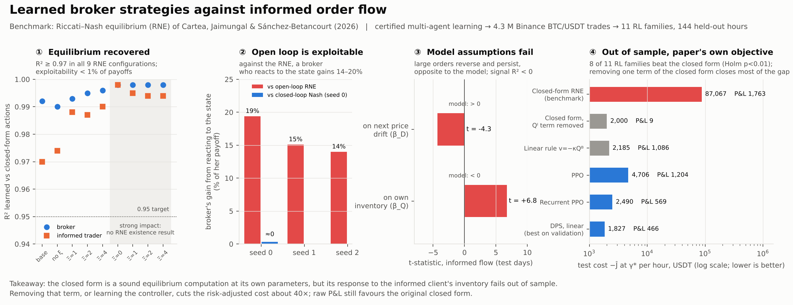
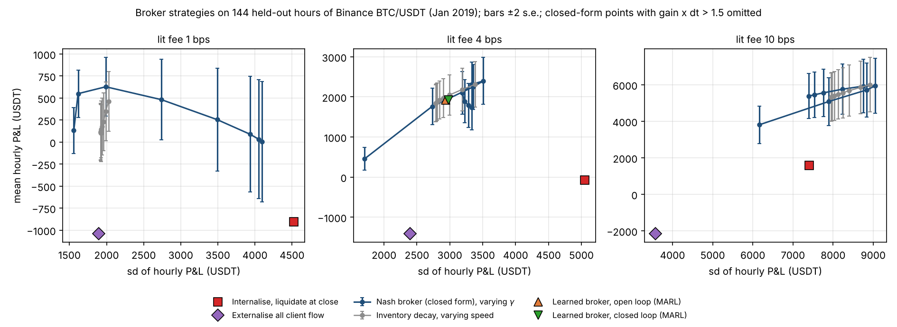
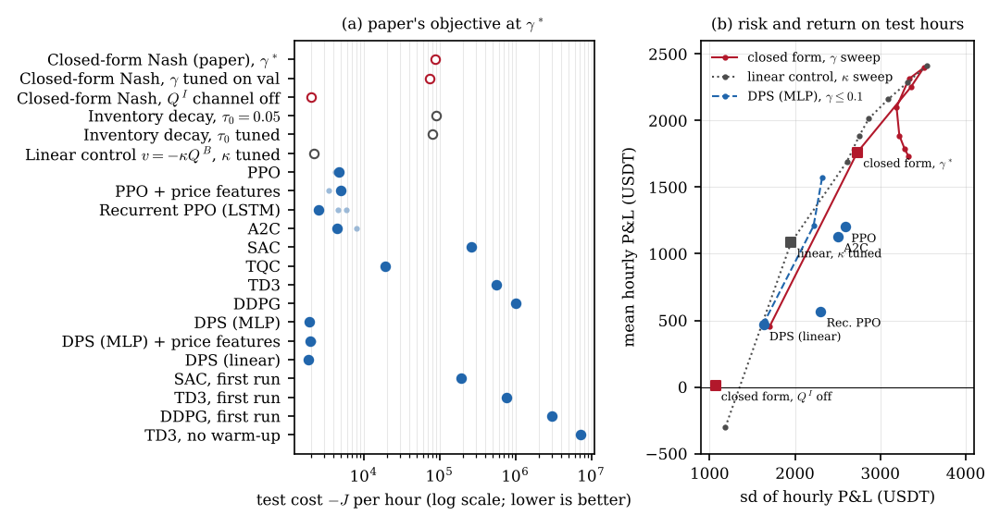

# Broker–informed-trader game: a real-data test



*Visual abstract. Regenerate with `python scripts/make_visual_abstract.py`.*


A test of the broker–trader Nash equilibrium of Cartea, Jaimungal & Sánchez-Betancourt (2026,
*Finance and Stochastics* 30:951–982), and of multi-agent learned brokers, on public Binance
BTC/USDT tick data.

**Bottom line.** On 144 held-out hours, the closed-form Nash broker beats the simple baselines at
very low trading costs (1 bps), but not at 4 or 10 bps. There, a one-line inventory-decay rule does
as well or better, and learned brokers tie with that rule. The model's two behavioural assumptions
about informed flow are rejected by this data, and the closed-form broker's profit comes from a
different channel than the model intends.

## What is being tested

There is no public dataset with a real broker's client book, so this is a **counterfactual
backtest**:

| Piece | How it is built |
|---|---|
| Clients | Every aggressive parent order on Binance (fills grouped by order id) is treated as a client order sent to a hypothetical broker. |
| Informed vs uninformed | **Proxy:** parent orders at or above the 95th size percentile of *training* days are "informed" (49% of test-day volume); all others are "uninformed". Checked on test days with markouts. |
| Prices | Real trade prices, plus the broker's own Obizhaeva–Wang transient impact (modelled, since she is hypothetical). |
| Model parameters | Calibrated on 14 training days only: volatility, signal, OU uninformed flow, impact (Υ, Ξ), costs. |
| Test | 6 held-out days = 144 one-hour episodes on a 30-second grid, with no look-ahead: the broker sees last bin's flows and a lagged signal. |
| Data | `BTCUSDT` 2019-01-01..2019-01-20 files from [github.com/Nucs/cryptocurrency-ticks-data](https://github.com/Nucs/cryptocurrency-ticks-data) (Unlicense): 4,307,535 trades with buyer/seller order ids. Timestamps run 31 Dec 2018 – 19 Jan 2019 (the source warns of date offsets). |

**Strategies compared** (all see the same information):

1. **Nash broker (closed form):** the paper's Riccati strategy with calibrated parameters.
2. **Ablations:** the same strategy with the signal α switched off; with the informed client's inventory Q^I switched off.
3. **Learned brokers (MARL):** open-loop and closed-loop equilibrium agents trained in the calibrated simulator, then run on real data (4 bps only).
4. **Baselines:** internalise everything and liquidate at the close; externalise all client flow; inventory decay v = −Q^B/(T − t + τ₀).

Risk aversion: inventory penalties follow the paper's ratio φ/a ≈ 833, plus a mean–variance
running penalty r = γσ²/2. The operating point γ* is picked by best Sharpe on **training** hours.
Whole frontiers are traced by varying γ (closed form) and τ₀ (inventory decay).

## Results



Full tables: [`results/RESULTS.md`](results/RESULTS.md). Raw numbers: `results/results_fee*bps.json`.

**At the operating point γ\*, 4 bps lit fee (paired differences on the same 144 hours):**

| Strategy | Mean P&L/h (USDT) | Sharpe/h | vs closed-form Nash |
|---|---|---|---|
| Nash broker (closed form) | +1,763 | 0.645 | — |
| Nash, signal off | +1,777 | 0.646 | +14 ± 2 |
| Nash, informed-inventory channel off | +9 | 0.008 | −1,754 ± 210 |
| Learned broker, open loop | +1,919 | 0.653 | **+156 ± 39** |
| Learned broker, closed loop | +1,928 | 0.648 | **+166 ± 39** |
| Inventory decay (τ₀ = 0.05 h) | +1,924 | 0.676 | +161 ± 81 |
| Internalise, liquidate at close | −72 | −0.014 | −1,835 ± 491 |
| Externalise all client flow | −1,407 | −0.586 | −3,170 ± 382 |

P&L includes the spread charged to clients, which is the same for every strategy (b = c = a); the
tables in `RESULTS.md` also show P&L net of it.

**Findings:**

1. **The size proxy is only weakly informed.** Large orders have positive markouts at 10 s
   (+0.37 ± 0.04 bps) that fade by 5 min (+0.16 ± 0.14 bps, not significant). Small orders lose about
   0.4 bps, i.e. the spread.
2. **Both of the model's assumptions about informed flow fail here.** After excluding a bin's own
   price impact, "informed" flow is followed by price *reversal* (t = −4.3), not continuation. Both
   flows *persist* (positive loading on their own inventory, t = +6.8 and +18.1) instead of unwinding.
   The signal built from informed flow has no forecasting power (test R² = −0.004).
3. **The closed form earns its money through a channel the model doesn't intend.** Switching off the
   informed-inventory term removes almost all of its P&L (−1,754 ± 210/h) and cuts terminal inventory
   from 58 to 3 BTC. Waiting for an unwind that never comes means carrying inventory against large
   orders, and that happens to pay because their impact reverts. The signal itself adds nothing (+14 ± 2/h
   with it switched off).
4. **Low costs favour the closed form; higher costs don't.** At 1 bps the closed-form frontier
   dominates inventory decay: at the same risk (sd ≈ 1,990/h) it earns +628/h vs +349/h, and it reaches
   lower risk than any decay setting. At 4 and 10 bps the two frontiers overlap, and at γ* inventory
   decay is ahead by +161 ± 81/h (4 bps) and +397 ± 82/h (10 bps).
5. **The learned brokers beat the closed form on real data, by +156 to +166 ± 39/h.** The reason is
   discretisation: at γ* the closed-form gain on inventory times the step is 1.05, so on a 30-second
   grid it overshoots. In the calibrated simulator the learned brokers score 104 vs 61 for the sampled
   closed form. On real data they tie with the inventory-decay rule.

**Limitations.**
- One market, 20 days (January 2019), 144 test hours. P&L sd is about 2,700/h, so only paired
  differences are tight.
- "Informed" is a size proxy, not an identity. A real test needs labelled client flow: a broker's book,
  or on-chain swaps with addresses (see below).
- The broker is hypothetical: her impact is modelled, and the client charge b = c = a is an assumption.
- Learned agents were trained only for the 4 bps case.
- At high risk aversion the sampled closed form becomes unstable on the 30-second grid (gain × dt
  approaching 2). Those points appear in the tables and are left out of the plots.

## Reinforcement-learning benchmark

Eleven RL broker families are trained directly on replayed training hours and compared with the
closed-form Nash broker on the same 144 held-out hours. The families are PPO, PPO with price
features, recurrent PPO (LSTM), A2C, SAC, TQC, TD3, DDPG, and differentiable policy search (DPS)
with linear, MLP and MLP + price-feature policies.

- **Protocol:** train on 11 days; pick the checkpoint and the seed on the 3 validation days; evaluate
  once on the 6 test days.
- **Objective:** the paper's own, P&L − running inventory penalty − terminal penalty, at γ* = 0.1.
- **Statistics:** paired tests with Holm correction.

| Strategy (seed chosen on validation) | Test objective J / h | J − closed form | Mean P&L / h |
|---|---:|---:|---:|
| Closed-form Nash broker (paper), γ* | −87,067 | — | 1,763 |
| Closed form with its Q^I (informed-inventory) term removed | −2,000 | +85,067 ± 22,649 | 9 |
| Linear control v = −κQ^B, κ tuned on validation | −2,185 | +84,882 ± 22,625 | 1,086 |
| **DPS, linear (best on validation)** | **−1,827** | **+85,240 ± 22,681** | 466 |
| DPS, MLP | −1,914 | +85,153 ± 22,653 | 540 |
| Recurrent PPO | −2,490 | +84,577 ± 22,567 | 569 |
| PPO / A2C | −4,706 / −4,444 | ≈ +82,500 | 1,204 / 1,131 |
| TQC | −18,800 | +68,267 ± 21,758 | −3,506 |
| SAC / TD3 / DDPG | diverged | negative | negative |

- **Learned brokers beat the paper on its own objective.** 8 of 11 families improve on it with Holm
  p < 0.01, by more than an order of magnitude. The closed form keeps a large position against the
  informed client's accumulated inventory, which never unwinds in the data.
- **The gain is inventory control, not better information use.** Removing that one term from the
  closed form recovers most of the gap. DPS-linear still beats the repaired closed form by +173 ± 51
  (p < 0.001) and the linear rule by +358 ± 87.
- **Comparison across risk aversion.** At every γ ∈ {0.001, 0.01, 0.1} every alternative beats the
  unrepaired closed form. At γ ≤ 0.01 the repaired closed form is the best strategy.
- **Raw P&L.** The unrepaired closed form earns more than every RL broker selected on the
  risk-penalised objective.
- **Off-policy methods** (SAC, TD3, DDPG) diverged with standard hyperparameters. A larger reward scale
  and removing the random warm-up did not fix them. Both runs are kept as diagnostics.

```bash
pip install -r requirements.txt     # includes stable-baselines3 and sb3-contrib
scripts/run_rl_all.sh               # baselines, 11 families x seeds, then the risk-return frontier
python scripts/run_rl_gamma_table.py 0.001; python scripts/run_rl_gamma_table.py 0.01; python scripts/run_rl_gamma_table.py 0.1
python scripts/make_rl_report.py    # results/rl_benchmark/RESULTS_RL.md, summary.json, rl_benchmark.png/pdf
```



## Run it

```bash
pip install -r requirements.txt
scripts/get_data.sh                                  # fetches the 20 BTCUSDT files (~67 MB) from GitHub
python scripts/run_test.py --fee_bps 4               # full test incl. learned agents (~20 min, 2 CPU cores)
python scripts/run_test.py --fee_bps 1 --no_learned  # sensitivity runs (~1 min each)
python scripts/run_test.py --fee_bps 10 --no_learned
python scripts/make_report.py                        # results/RESULTS.md and results/frontiers.png
```

`get_data.sh SYMBOL 'REGEX'` fetches other symbols or dates. Files from `data.binance.vision` work
via `realdata.loaders.load_binance_vision_trades`, but they carry no order ids, so each print is its
own parent order.

**Labelled test (not run here).** The strongest available test uses on-chain swaps, where identities
are public: e.g. the Uniswap v3 ETH/USDC swaps with MEV-bot labels on
[Zenodo](https://zenodo.org/records/18674644) (CC BY 4.0), with Binance as the lit venue. This
workspace could not reach Zenodo or Binance. To run it, write a loader mapping each swap to
(time, price, qty, side) and set `informed` from the bot labels instead of the size rule; the rest of
the pipeline is unchanged.

## Layout

```
realdata/loaders.py     tick-file loaders (Nucs/Binance with order ids; data.binance.vision)
realdata/flow.py        parent orders, informed/uninformed proxy, markouts, binned flows
realdata/calibrate.py   OU fits, signal, Obizhaeva-Wang impact, costs
realdata/backtest.py    counterfactual broker backtest + baseline strategies
realdata/pipeline.py    shared data preparation with a train / validation / test split
realdata/rl.py          gymnasium replay environment, SB3 wrapper, differentiable policy search
brokergame/             the game: simulator, Riccati solution, learned agents (from the paper repo)
scripts/                get_data.sh, run_test.py, make_report.py, run_rl_*.py/.sh, make_rl_report.py
results/                RESULTS.md, frontiers.png/pdf, results_*.json, log.txt, rl_benchmark/
```

## Licence

Code: [MIT](LICENSE). The Binance trade data fetched by `scripts/get_data.sh` come from [Nucs/cryptocurrency-ticks-data](https://github.com/Nucs/cryptocurrency-ticks-data) under the Unlicense and are not redistributed here.
